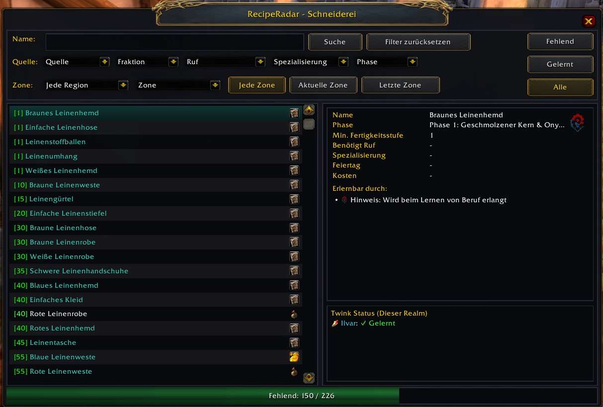
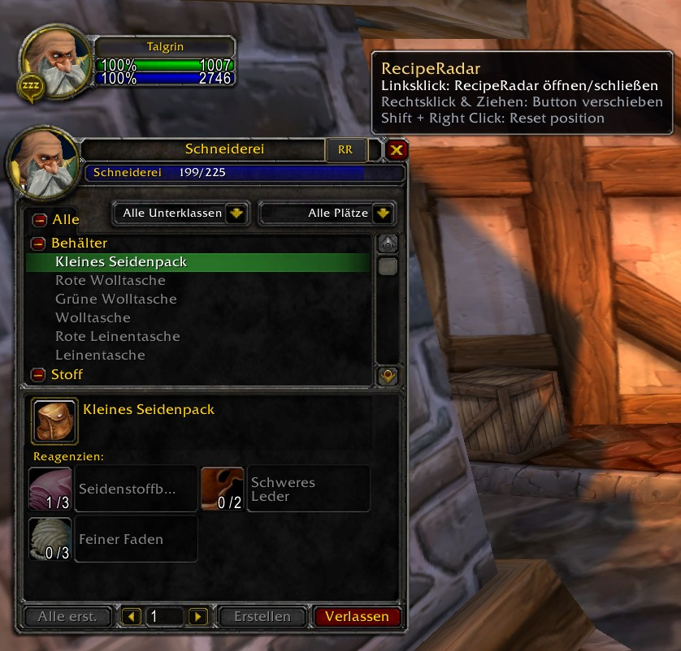
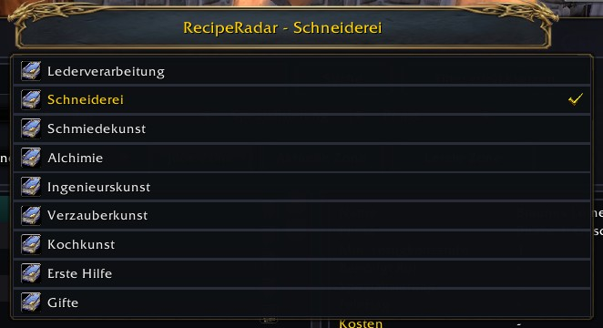

# RecipeRadar

**RecipeRadar** is a modern, standalone profession recipe and skill tracker for **World of Warcraft Classic Era** and **TBC Anniversary**.

It helps you discover every missing recipe, pattern, plan, schematic, and formula for all primary and secondary professions, showing you exactly where and how to obtain them with integrated TomTom coordinates in **10 languages**.

---

## Screenshots

  

  
  &nbsp;&nbsp;
  

---

## Features

* **Missing recipe finder**: Lists every recipe, pattern, plan, schematic, and formula for all primary and secondary professions, and shows where to get it (trainer, vendor, quest, drop, object, or holiday).
* **Missing / Known / All views**: Switch between recipes you still need, the ones you already know, or everything.
* **Filters**: Narrow the list by source, zone (any, current, or last visited), faction, reputation, specialization, and content phase. Classic Era phases 1–6 and TBC phases 1–5 are supported.
* **TomTom waypoints**: Click a coordinate or NPC name to place a waypoint on your map.
* **Alt tracking**: Tooltips on recipes and crafted items show which of your characters on the realm already know the recipe.
* **Profession window button**: An `RR` button attaches to the trade skill window. It follows the window when other UI addons (DragonflightUI, ElvUI) move it, and can be detached and repositioned.
* **Settings & alt management**: Choose which characters appear in tooltips, delete old characters, and see learned vs. missing recipe counts per profession.
* **Minimap button**: A standard LibDBIcon button, so minimap button managers can collect and hide it.
* **10 languages**: English, German, French, Spanish, Mexican Spanish, Russian, Simplified Chinese, Traditional Chinese, Korean, and Portuguese.

---

## How to Use

1. Click the **Minimap button** or open your in-game **Profession / Trade Skill** window and click the attached **RR button** (or type `/rr`).
2. Use the top filter bar to filter by status, zone, phase, faction, reputation, or acquisition source.
3. Click on any NPC coordinate to automatically set a TomTom waypoint.
4. Right-click the minimap button or the attached RR button at any time to open the **Settings & Alt Management** window (or type `/rr config`).

---

## Slash Commands

* `/rr` or `/reciperadar` – Toggle RecipeRadar main window
* `/rr config`, `/rr options`, or `/rr opt` – Open Settings and Character/Alt Management window
* `/rr minimap` or `/rr mm` – Toggle minimap button visibility
* `/rr reset` – Reset window and button positions to defaults
* `/rr help` – Display available commands in chat
* `/rr debug` – Toggle live verbose debug logging for recipe and tooltip resolution

---

## Installation

1. Download the latest release package.
2. Extract the folder into your `World of Warcraft\_classic_era_\Interface\AddOns\` directory.
3. Ensure the folder is named `RecipeRadar`.
4. Restart World of Warcraft or reload your UI with `/reload`.

---

## Support & Feedback

If you enjoy using RecipeRadar and want to support ongoing development, maintenance, and future expansions, consider buying me a coffee!

---

## License & Credits

* **Developer & Maintainer**: rakStar
* **Donations**: [https://ko-fi.com/rakstar91](https://ko-fi.com/rakstar91)
* **Changelog**: See [CHANGELOG.md](CHANGELOG.md) for release notes.
* **License**: [All Rights Reserved](LICENSE) (Copyright © 2026 rakStar)
